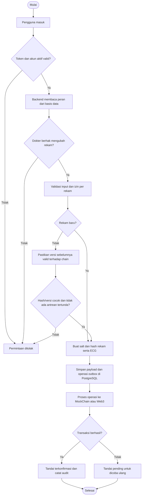
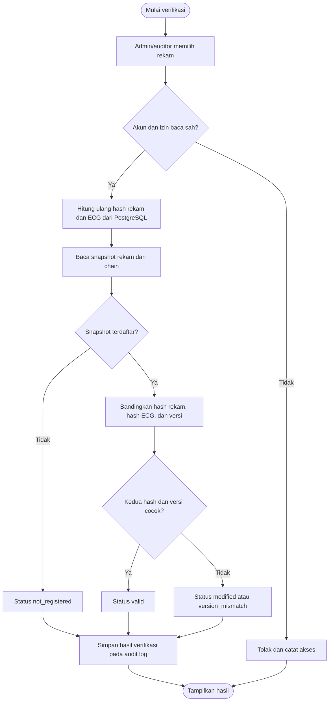

# Materi Lomba MediChain

## Platform Rekam Medis Terintegrasi Berbasis Blockchain

**Kategori:** IT Healthcare  
**Acuan proyek di repository:** IEIC 2026  
**Versi materi:** 25 Oktober 2026  
**Tim/sekolah:** [isi nama tim dan sekolah]  
**Anggota:** [isi nama anggota dan pembagian tugas]

> **Posisi produk yang harus konsisten saat presentasi:** MediChain adalah prototipe untuk membantu memeriksa integritas dan mengelola akses rekam medis. Data klinis tetap disimpan di PostgreSQL. Blockchain mencatat hash, versi, waktu, dan metadata akses. Data demo dan ECG yang digunakan bersifat sintetis. Sistem ini belum merupakan produk klinis siap pakai.

## 1. Ringkasan proyek

MediChain adalah aplikasi web untuk mengelola rekam medis digital dengan bukti integritas berbasis blockchain. Data pasien dan data klinis disimpan di basis data PostgreSQL. Aplikasi menghitung sidik jari kriptografis menggunakan SHA-256 atas data rekam dan ECG, kemudian menyimpan hash tersebut ke blockchain melalui smart contract. Ketika rekam diperiksa, aplikasi menghitung ulang hash dari basis data dan membandingkannya dengan hash yang tercatat di chain. Perbedaan hash dapat menunjukkan bahwa data berubah sejak snapshot yang dicatat.

Sistem dilengkapi autentikasi, hak akses berbasis peran dan rekam, jejak audit, status sinkronisasi transaksi, ekspor data berstruktur FHIR R4, serta berbagi rekam dengan tautan terbatas waktu yang dapat dicabut pasien. Mode **MockChain** mendukung demo lokal; integrasi **Web3** disiapkan untuk Ethereum Sepolia.

**Kalimat pengenal satu napas:**

> “MediChain menjaga data medis tetap berada di basis data layanan, lalu menambahkan bukti hash pada blockchain agar perubahan data dapat diperiksa dan aktivitas akses dapat ditelusuri.”

## 2. Abstrak

Digitalisasi rekam medis membantu tenaga kesehatan mengelola informasi pasien, tetapi organisasi juga perlu menjaga kerahasiaan, membatasi akses, menelusuri aktivitas, dan mengetahui apabila data berubah. MediChain dikembangkan sebagai prototipe aplikasi rekam medis yang menggabungkan penyimpanan basis data relasional dengan pencatatan hash pada blockchain. Data rekam medis dan ECG disimpan secara off-chain; hash bersalt dihitung secara terpisah dan dicatat on-chain bersama versi dan waktu. Backend memeriksa autentikasi, peran, dan izin terhadap rekam sebelum melayani permintaan. Fitur lain mencakup audit log berantai, sinkronisasi transaksi yang dapat dicoba ulang, simulasi perubahan data, ekspor Bundle berstruktur FHIR R4, dan berbagi rekam terbatas waktu. Pengujian yang tercatat di README proyek menggunakan SQLite sementara dan MockChain, serta meliputi deteksi perubahan data, penolakan akses, alur API, dan integritas audit. Pemeriksaan terakhir yang dicatat proyek menyebut 16 tes backend lulus serta pemeriksaan TypeScript dan build Next.js berhasil. Hasil ini menunjukkan kelayakan fungsi prototipe pada lingkungan uji, bukan bukti kesiapan operasional klinis. Seluruh data demo bersifat sintetis dan ECG bukan sinyal untuk diagnosis.

**Kata kunci:** rekam medis elektronik, blockchain, SHA-256, integritas data, kontrol akses, audit log, interoperabilitas.

## 3. Latar belakang

Rekam medis digital bernilai bagi pelayanan karena dapat menyatukan informasi riwayat, diagnosis, catatan, status perawatan, dan hasil pengamatan. Namun, penyimpanan digital juga menimbulkan kebutuhan untuk memastikan hanya pengguna berwenang yang melihat atau mengubah data serta menyediakan cara untuk memeriksa perubahan yang tidak semestinya.

Dalam sistem yang hanya bergantung pada satu basis data, catatan dapat berubah karena pembaruan yang sah, kesalahan operasional, atau tindakan yang tidak berwenang. Log pada sistem yang sama juga perlu dilindungi agar dapat dipercaya sebagai bukti. Tantangan ini menjadi lebih penting ketika beberapa peran bekerja pada rekam yang sama dan ketika pasien perlu membagikan ringkasan tertentu kepada pihak lain.

MediChain mengeksplorasi arsitektur hibrida. Basis data tetap menangani penyimpanan dan pembacaan data klinis, sedangkan blockchain dipakai sebagai lapisan pembanding integritas dan pencatat transaksi yang sulit diubah setelah dikonfirmasi jaringan. Pemisahan ini bertujuan menghindari penempatan data medis mentah pada jaringan publik.

> Peraturan Menteri Kesehatan Nomor 24 Tahun 2022 tentang Rekam Medis menyebut penyelenggaraan rekam medis elektronik dengan prinsip keamanan dan kerahasiaan data dan informasi sebagai bagian dari konteks transformasi digital kesehatan. Undang-Undang Nomor 27 Tahun 2022 tentang Pelindungan Data Pribadi menggolongkan data dan informasi kesehatan sebagai data pribadi spesifik. Rujukan ini menjadi konteks perancangan, bukan pernyataan bahwa MediChain telah memenuhi seluruh kewajiban hukum atau regulasi. [Permenkes 24/2022 — JDIH BPK](https://peraturan.bpk.go.id/Details/245544/permenkes-no-24-tahun-2022), [UU 27/2022 — JDIH BPK](https://peraturan.bpk.go.id/Details/229798/uu-no-27-tahun-2022)

### 3.1 Identifikasi masalah

1. Perubahan data digital perlu dapat diketahui dan ditinjau.
2. Informasi kesehatan perlu dibatasi berdasarkan pengguna, peran, dan kepemilikan rekam.
3. Aktivitas penting seperti pembacaan, penolakan akses, pembaruan, dan verifikasi perlu memiliki jejak audit.
4. Data rekam medis terlalu sensitif untuk ditaruh sebagai data mentah di blockchain publik.
5. Integrasi antarsistem kesehatan memerlukan struktur data yang dapat dipertukarkan.

Poin tersebut merupakan rumusan kebutuhan desain. Materi ini tidak mengklaim telah melakukan survei lapangan atau mengukur prevalensi masalah di fasilitas kesehatan tertentu.

### 3.2 Rumusan masalah

1. Bagaimana menyimpan bukti integritas rekam medis tanpa menaruh data klinis mentah di blockchain?
2. Bagaimana membatasi akses rekam berdasarkan peran dan hubungan pengguna dengan pasien?
3. Bagaimana mendeteksi perubahan pada data rekam dan ECG setelah hash awal dicatat?
4. Bagaimana menjaga jejak aktivitas dan menangani transaksi blockchain yang gagal sementara?
5. Bagaimana menyediakan ekspor data dengan struktur yang mendukung pertukaran informasi?

### 3.3 Tujuan

1. Membangun prototipe rekam medis web dengan peran admin, dokter, pasien, dan auditor.
2. Menyimpan data klinis di basis data dan mencatat hash-nya di blockchain.
3. Menyediakan pemeriksaan integritas terpisah untuk data rekam dan ECG.
4. Membatasi operasi dengan autentikasi, RBAC, ACL per rekam, dan pemeriksaan kepemilikan pasien.
5. Menyediakan audit log, status antrean transaksi, dan mekanisme percobaan ulang.
6. Menyajikan ekspor rekam dalam Bundle berstruktur FHIR R4 dan berbagi rekam dengan persetujuan pasien.

### 3.4 Manfaat yang diharapkan

- **Pasien:** memperoleh akses terhadap rekam miliknya serta kendali untuk membuat atau mencabut tautan berbagi tertentu.
- **Dokter:** mengakses rekam sesuai izin dan memperbarui bagian klinis yang menjadi kewenangannya.
- **Admin/auditor:** meninjau akun, izin, status sinkronisasi, integritas, dan jejak aktivitas sesuai peran.
- **Pengelola sistem:** memiliki prototipe yang menunjukkan cara memisahkan data klinis dari bukti integritas on-chain.
- **Pengembang:** dapat menguji pola hashing, kontrol akses, audit, dan sinkronisasi melalui lingkungan sintetis.

Manfaat ini adalah potensi desain yang perlu divalidasi lebih lanjut bersama pengguna dan pengelola fasilitas kesehatan.

### 3.5 Batasan ruang lingkup

- Sistem adalah prototipe, bukan sistem informasi rumah sakit yang tervalidasi.
- Seluruh data contoh bersifat sintetis; tidak ada klaim penggunaan pada pasien nyata.
- ECG dihasilkan oleh fungsi sintetis, 250 Hz selama 8 detik, hanya untuk visualisasi dan uji integritas.
- Mode MockChain dapat dipakai untuk demo. Kode integrasi Web3 disiapkan untuk Sepolia, tetapi README menyatakan kompilasi dan deployment Solidity belum dilakukan pada pemeriksaan terakhir.
- Hasil FHIR merupakan ekspor berstruktur FHIR R4; belum ada klaim sertifikasi atau uji interoperabilitas dengan sistem eksternal.
- Belum dilakukan audit keamanan pihak ketiga, uji penetrasi, validasi klinis, atau uji operasional pada fasilitas kesehatan.

## 4. Dasar teori

### 4.1 Rekam medis elektronik dan privasi

Rekam medis elektronik mengelola informasi pasien dan pelayanan dalam bentuk digital. Karena informasi kesehatan bersifat sensitif, sistem perlu mempertimbangkan kerahasiaan, integritas, ketersediaan, pembatasan hak akses, pencatatan aktivitas, serta tata kelola retensi dan pemrosesan data. UU PDP 27/2022 menempatkan informasi kesehatan sebagai data pribadi spesifik. Karena itu, prototipe ini memakai data sintetis dan tidak boleh dipresentasikan sebagai sistem yang sudah memperoleh persetujuan atau sertifikasi untuk pemrosesan data pasien nyata.

### 4.2 Blockchain

Blockchain adalah basis data terdistribusi yang menyimpan transaksi secara berurutan dalam blok yang saling terhubung secara kriptografis. Pada jaringan publik, transaksi dan interaksi kontrak dapat diamati. Sifat ini berguna untuk membandingkan bukti yang dicatat dengan keadaan basis data, tetapi transparansi juga berarti informasi yang ditulis harus dipilih secara hati-hati. [Ethereum.org — Blocks](https://ethereum.org/developers/docs/blocks/)

Dalam MediChain, blockchain **bukan** tempat menyimpan rekam medis lengkap. Kontrak menyimpan hash rekam, hash ECG, versi, timestamp, serta informasi pengendali akses berbentuk hash peran. Smart contract juga menyimpan alamat penulis transaksi dan menghasilkan event yang dapat ditelusuri. Hash dan metadata transaksi tetap dapat bersifat publik dan dapat dikorelasikan; desain ini tidak boleh disebut anonimisasi sempurna.

### 4.3 Smart contract

Smart contract adalah program dan state yang berjalan pada jaringan Ethereum dan dipanggil menggunakan transaksi atau operasi baca. MediChain memakai Solidity `^0.8.20`. Kontrak menyediakan fungsi registrasi, pembaruan, pembacaan, verifikasi hash, kontrol writer, jeda darurat, dan pencatatan izin/event. [Ethereum.org — Introduction to smart contracts](https://ethereum.org/developers/docs/smart-contracts/)

Kontrak tidak otomatis membuat input menjadi benar. Jika aplikasi mencatat hash dari data yang keliru, blockchain tetap hanya membuktikan bahwa hash tersebut telah dicatat. Karena itu, integritas bukti berbeda dari kebenaran klinis isi rekam.

### 4.4 Fungsi hash SHA-256 dan salt

Fungsi hash mengubah pesan menjadi digest berukuran tetap. SHA-256 menghasilkan digest 256-bit dan perubahan input akan menghasilkan digest berbeda dengan probabilitas yang sangat tinggi. NIST mendokumentasikan SHA-256 dalam Secure Hash Standard sebagai algoritma untuk menghasilkan digest yang membantu mendeteksi perubahan pesan. [NIST FIPS 180-4](https://csrc.nist.gov/pubs/fips/180-4/upd1/final)

Implementasi MediChain membuat representasi JSON kanonik agar urutan key tidak mengubah hasil hash. Data rekam dan ECG dihitung terpisah dengan salt acak 128-bit yang disimpan off-chain. Salt membuat hash untuk data yang sama berbeda jika salt berbeda dan memperkecil risiko serangan tabel pra-hitung.

**Hash bukan enkripsi.** Hash tidak dapat digunakan untuk membuka kembali data, tetapi juga tidak menyembunyikan seluruh risiko. Jika basis data dan salt ikut bocor, penyerang masih dapat menguji tebakan atas nilai tertentu. Data klinis perlu tetap dilindungi dengan kontrol keamanan basis data dan tata kelola yang sesuai.

Secara ringkas:

```text
hash_rekam = SHA-256(salt_rekam || JSON_kanonik(data_rekam))
hash_ECG   = SHA-256(salt_ECG   || JSON_kanonik(fs, sampel_ECG_terkuantisasi))
```

### 4.5 Penyimpanan off-chain dan on-chain

- **Off-chain:** data profil dan klinis berada di PostgreSQL; salt juga disimpan di basis data dan tidak dikirim ke klien.
- **On-chain:** kontrak mencatat hash, versi, waktu, writer, serta metadata/event yang diperlukan.
- **Manfaat desain:** data besar dan sensitif tidak ditulis sebagai plaintext ke jaringan publik, sementara hash dapat dipakai untuk pemeriksaan integritas.
- **Batas desain:** blockchain tidak mengenkripsi data off-chain, tidak menjamin data klinis benar, dan tidak otomatis mencegah kebocoran dari aplikasi atau basis data.

### 4.6 RBAC dan ACL

**Role-Based Access Control (RBAC)** menetapkan kewenangan berdasarkan peran. **Access Control List (ACL)** pada MediChain menyimpan izin baca per peran dan rekam. Backend memeriksa izin dan kepemilikan sebelum mengirim data. Pasien hanya boleh membaca rekam miliknya. Dokter dibatasi pada rekam yang diizinkan dan penugasan klinis. Auditor dan admin memiliki fungsi administrasi sesuai implementasi.

Penting: pencatatan izin pada kontrak merupakan metadata/proof; pembatasan akses ke data klinis pada aplikasi tetap ditegakkan oleh backend. Smart contract publik tidak menjadi lapisan kerahasiaan data.

### 4.7 Audit log berantai

Setiap entri audit dihubungkan dengan hash entri sebelumnya. Jika suatu entri diubah atau dihapus di tengah rantai, pemeriksaan ulang akan menemukan ketidakcocokan. Rantai ini membantu mendeteksi perubahan, tetapi tidak dapat sendiri mendeteksi pemotongan bagian paling akhir tanpa pembanding eksternal. MediChain juga menyediakan event blockchain untuk aktivitas tertentu sebagai lapisan pembanding.

### 4.8 Outbox dan sinkronisasi

Basis data dan blockchain adalah dua sistem berbeda sehingga satu transaksi atomik yang mencakup keduanya tidak tersedia. MediChain menyimpan perubahan dan operasi blockchain pada tabel outbox dalam transaksi basis data, kemudian memproses antrean. Jika RPC gagal, operasi berstatus pending dan dapat dicoba ulang. Idempotensi dan pemeriksaan versi membantu penanganan pemrosesan ulang. Pola ini mengurangi kehilangan maksud transaksi, tetapi tidak menghapus seluruh kemungkinan ketidaksesuaian atau gangguan layanan.

### 4.9 FHIR R4

FHIR (Fast Healthcare Interoperability Resources) adalah standar HL7 untuk pertukaran informasi kesehatan elektronik. FHIR menyusun informasi sebagai resource yang dapat dirangkai sesuai kebutuhan. MediChain menyediakan Bundle berstruktur FHIR R4, antara lain Patient, Encounter, Condition, Observation, dan resource klinis terkait. Ekspor ini merupakan langkah menuju pertukaran data; interoperabilitas penuh memerlukan pemetaan terminologi, profil, validasi, persetujuan, dan pengujian dengan sistem tujuan. [HL7 FHIR R4 — Overview](https://www.hl7.org/fhir/R4/overview.html)

## 5. Metode perancangan dan implementasi

Materi ini mendeskripsikan metode sebagai **rancang-bangun prototipe** berdasarkan artefak repository, bukan sebagai penelitian lapangan formal. Tahap yang dapat dipaparkan:

1. **Analisis kebutuhan:** identifikasi kebutuhan integritas, kontrol akses, audit, dan pertukaran data.
2. **Perancangan:** pilih arsitektur hibrida; basis data untuk payload, blockchain untuk hash/metadata, backend sebagai penegak izin.
3. **Implementasi:** buat UI web, API, model PostgreSQL, algoritma hash, audit log, outbox, dan smart contract.
4. **Pengujian terisolasi:** gunakan data sintetis, SQLite sementara, dan MockChain untuk menguji alur dan skenario perubahan.
5. **Evaluasi:** nilai apakah fungsi prototipe menghasilkan status integritas dan penolakan akses sesuai skenario uji; tidak menyimpulkan kesiapan klinis.

### 5.1 Arsitektur sistem

| Lapisan | Teknologi/komponen | Tanggung jawab |
|---|---|---|
| Antarmuka | Next.js, React, TypeScript | Portal peran, dashboard, rekam, integritas, audit, dan fitur administrasi |
| API | FastAPI, Python, Pydantic | Autentikasi, validasi, otorisasi, logika klinis, FHIR, dan endpoint aplikasi |
| Penyimpanan | PostgreSQL, SQLAlchemy, Alembic | Data akun, profil, rekam, ECG, izin, aktivitas, audit, dan outbox |
| Integritas | SHA-256, canonical JSON, salt acak | Membuat sidik jari terpisah untuk isi rekam dan ECG |
| Ledger simulasi | MockChain | Menjalankan demo tanpa transaksi jaringan publik |
| Ledger testnet | Solidity, web3.py, Ethereum Sepolia | Mencatat hash/event melalui transaksi testnet saat dikonfigurasi |

### 5.2 Peran pengguna

| Peran | Fungsi utama dalam prototipe |
|---|---|
| Admin | Mengelola akun, tagihan, status perawatan, jadwal, tracking, dan fungsi administrasi yang diizinkan |
| Dokter | Membaca rekam yang diizinkan dan memperbarui catatan klinis sesuai akses/penugasan |
| Pasien | Membaca rekam miliknya, informasi perawatan, jadwal, tagihan, dan mengatur tautan berbagi |
| Auditor | Meninjau log dan integritas serta mengelola kontrol akses sesuai kebijakan aplikasi |

### 5.3 Alur pembuatan atau pembaruan rekam



### 5.4 Alur verifikasi integritas



Status yang dapat dijelaskan: `valid` berarti hash dan versi cocok; `modified` berarti setidaknya satu hash berbeda; `version_mismatch` berarti hash cocok tetapi versi berbeda; `not_registered` berarti belum ada snapshot on-chain; `sync_pending` dapat muncul saat operasi menunggu sinkronisasi.

### 5.5 Alur berbagi rekam

Pasien pemilik rekam memilih cakupan `summary` atau `full`, menambahkan tujuan bila dibutuhkan, lalu membuat tautan/QR dengan token acak. Backend menyimpan hash token, bukan token mentah, serta menerapkan masa berlaku. Pasien dapat melihat akses berbagi dan mencabut tautan. Fitur berbagi tetap harus diperlakukan sebagai kanal sensitif: penerima yang memiliki tautan aktif dapat membuka data yang diizinkan dalam cakupannya.

## 6. Implementasi fitur

1. **Autentikasi:** password di-hash dengan scrypt; sesi menggunakan JWT berumur 30 menit. Peran diambil dari database pada tiap request.
2. **Pendaftaran pasien:** pendaftaran publik hanya membuat akun pasien pending; akun belum dapat mengakses data sampai disetujui admin/auditor. Jalur OTP email dinonaktifkan secara default pada konfigurasi repository.
3. **Kontrol akses:** role check, ACL per rekam, pemeriksaan kepemilikan pasien, dan pembatasan dokter sesuai penugasan.
4. **Rekam dan ECG:** catatan klinis disimpan off-chain. ECG demo dibangkitkan secara sintetis dan hanya ditampilkan pada status perawatan yang diizinkan.
5. **Integritas:** rekam dan ECG memakai hash terpisah; backend membandingkan hasil hitung ulang dengan snapshot kontrak.
6. **Pencegahan pembaruan yang menutupi perubahan:** pembaruan rekam ditolak dengan HTTP 409 jika snapshot saat ini tidak valid terhadap chain.
7. **Audit:** audit log memakai hash berantai; akses yang ditolak dicatat pada audit dan, bila tersedia, dikirim sebagai event chain dengan pembatasan laju.
8. **Sinkronisasi:** outbox mempertahankan operasi yang belum terkonfirmasi dan menyediakan percobaan ulang admin/auditor.
9. **Ekspor dan berbagi:** Bundle FHIR R4, laporan PDF, serta tautan/QR sharing terbatas waktu.
10. **Alur layanan tambahan:** status perawatan, observasi tanda vital, alergi, obat, permintaan pemeriksaan, jadwal, tagihan, dan peringatan kelengkapan alur.

## 7. Hasil dan pembahasan

### 7.1 Hasil fungsional yang dapat didemonstrasikan

- Data rekam dan ECG yang identik menghasilkan hash yang dapat diverifikasi.
- Perubahan pada diagnosis atau sampel ECG menyebabkan hash terkait berbeda.
- Peran pasien tidak dapat membaca rekam pasien lain dan tidak dapat mengubah rekam.
- Dokter tanpa kewenangan verifikasi tidak dapat menjalankan endpoint verifikasi khusus admin/auditor.
- Pembaruan terhadap rekam yang hash-nya sudah tidak cocok ditolak dengan status 409.
- Operasi blockchain yang gagal sementara tetap pending dan dapat dicoba kembali.
- Audit log dapat diperiksa untuk mengetahui perubahan atau penghapusan entri di tengah rantai.
- API dapat menghasilkan Bundle FHIR dan dokumen PDF pada test alur API.

### 7.2 Status pengujian dalam repository

README mencatat pemeriksaan terakhir sebagai berikut:

- 16 tes backend lulus menggunakan SQLite dan MockChain terisolasi.
- Koneksi PostgreSQL dan 26 tabel aplikasi pernah diperiksa dengan query baca saja.
- Pemeriksaan TypeScript dan build Next.js berhasil.
- Pengujian tulis terhadap PostgreSQL pengguna, build image Docker, uji interaktif browser, serta kompilasi/deploy Solidity belum dilakukan pada pemeriksaan yang dicatat.

Informasi tersebut dikutip dari dokumentasi proyek dan tidak dijalankan ulang saat penyusunan materi ini. Hindari menyebut angka tersebut sebagai hasil uji produksi. Laporan pengujian dan README perlu dicocokkan kembali dengan versi aplikasi yang akan dipresentasikan.

### 7.3 Pembahasan nilai tambah

Nilai utama MediChain adalah pemisahan antara **isi medis** dan **bukti integritas**. Payload tetap dikelola oleh sistem basis data, sedangkan hash yang lebih kecil digunakan sebagai pembanding eksternal. Pemisahan hash rekam dan ECG membuat hasil verifikasi lebih terarah: sistem dapat menyatakan bagian mana yang cocok atau berubah.

Kontrol akses dan audit melengkapi hash. Hash saja tidak menentukan siapa yang boleh membaca data, sehingga keputusan akses tetap dilakukan backend. Outbox menanggapi kenyataan bahwa basis data dan chain dapat gagal pada waktu berbeda. FHIR menyiapkan bentuk pertukaran, tetapi belum membuktikan sistem lain dapat mengimpor dan memakainya tanpa penyesuaian.

### 7.4 Kebaruan dan kontribusi yang aman diklaim

Kontribusi prototipe ini adalah demonstrasi terintegrasi dari:

- hashing bersalt yang memisahkan rekam medis dan ECG;
- verifikasi versi dan hash pada snapshot on-chain;
- penolakan pembaruan ketika data lokal tidak cocok dengan snapshot terakhir;
- outbox untuk percobaan ulang saat sinkronisasi chain gagal;
- kontrol akses per peran/rekam, audit berantai, dan ekspor FHIR dalam satu aplikasi demo.

Jangan menyebut teknologi ini sebagai blockchain medis pertama, sistem yang tidak dapat diretas, sistem yang menjamin data benar, atau sistem yang sudah memenuhi standar klinis/regulasi.

### 7.5 Kapan blockchain layak dipakai?

Blockchain masuk akal bila beberapa pihak perlu memeriksa bukti yang sama tanpa hanya mengandalkan catatan internal satu sistem. Jika satu organisasi menjadi satu-satunya pengelola dan pemeriksaan independen tidak diperlukan, log append-only bertanda tangan atau layanan transparansi terpusat mungkin lebih sederhana dan murah. MediChain adalah eksplorasi manfaat dan trade-off tersebut; proyek ini belum membuktikan bahwa blockchain selalu lebih baik dari alternatif itu.

## 8. Kesimpulan dan saran pengembangan

MediChain berhasil dirancang sebagai prototipe pengelolaan rekam medis dengan pendekatan hibrida: data klinis tetap di PostgreSQL, sedangkan blockchain digunakan untuk menyimpan hash dan metadata integritas. Aplikasi menggabungkan kontrol akses berbasis peran, audit log, verifikasi data, antrean transaksi yang dapat dicoba ulang, serta ekspor berstruktur FHIR. Catatan pengujian repository menunjukkan fungsi-fungsi inti dapat diuji di lingkungan lokal sintetis.

Hasil ini membuktikan kelayakan fungsi prototipe pada skenario uji, bukan kelayakan klinis atau kepatuhan operasional. Pengembangan berikutnya sebaiknya mencakup audit smart contract dan uji penetrasi independen, evaluasi keamanan serta retensi data, uji interoperabilitas FHIR dengan sistem nyata yang disetujui, uji beban, pengelolaan kunci dan multisignature, pemantauan dan disaster recovery, serta evaluasi bersama tenaga kesehatan dan pemangku kebijakan sebelum penggunaan lebih luas.

### 8.1 Batasan dan risiko yang harus dinyatakan

- Hash membuktikan kecocokan snapshot, bukan kebenaran isi medis saat pertama dicatat.
- Pemegang kunci backend yang berwenang masih dapat mencatat hash baru; perlu tata kelola dan pemisahan tugas.
- Data off-chain tetap memerlukan enkripsi, backup, kontrol basis data, dan pengamanan infrastruktur yang sesuai.
- Transaksi publik menimbulkan biaya gas, latensi, dan paparan metadata; mode Sepolia adalah testnet, bukan bukti kesiapan mainnet.
- Komit basis data dan transaksi chain tidak atomik; outbox mengurangi risiko tetapi tetap memerlukan rekonsiliasi.
- Audit log lokal berantai tidak mendeteksi pemotongan ekor tanpa anchor pembanding.
- Rate limiter/lockout berada di memori satu proses; deployment multi-instance perlu penyimpanan terdistribusi.
- Belum ada audit eksternal smart contract, uji penetrasi, validasi klinis, maupun pengujian lapangan.
- Hash/salt bukan pengganti enkripsi payload dan bukan anonimisasi penuh.
- ECG sintetis tidak boleh digunakan untuk diagnosis atau keputusan klinis.

## 9. Rencana presentasi lomba

### 9.1 Susunan 10 slide

| Slide | Judul | Isi utama | Pesan lisan |
|---|---|---|---|
| 1 | MediChain | Judul, tim, kategori IT Healthcare | “Kami membangun cara untuk memeriksa integritas rekam medis digital.” |
| 2 | Masalah yang dituju | Perubahan data, akses, audit, pertukaran | Jelaskan kebutuhan desain tanpa statistik yang belum disurvei. |
| 3 | Tujuan dan pengguna | Pasien, dokter, admin, auditor | Tunjukkan kebutuhan tiap peran. |
| 4 | Ide utama | Database off-chain + hash on-chain | Tegaskan data mentah tidak masuk blockchain. |
| 5 | Dasar teknologi | SHA-256, salt, smart contract, RBAC, FHIR | Jelaskan konsep dalam bahasa sederhana. |
| 6 | Arsitektur | UI → FastAPI → PostgreSQL/outbox → MockChain/Sepolia | Tunjukkan jalur data dan retry. |
| 7 | Demo integritas | Data cocok → ubah diagnosis → hash berbeda | Perlihatkan perubahan terdeteksi dan update ditolak. |
| 8 | Hasil uji | Cakupan tes repo dan contoh hasil | Bedakan tes lokal dari uji produksi. |
| 9 | Batasan dan rencana | Privasi, gas, audit, uji lanjut | Tunjukkan pemahaman risiko dan langkah berikutnya. |
| 10 | Kesimpulan | “Data tetap privat; integritas dapat diperiksa” | Tutup dengan manfaat dan ajakan diskusi. |

### 9.2 Naskah presentasi sekitar 5 menit

**Slide 1 — Pembukaan**  
Selamat pagi/siang. Kami dari [nama tim] memperkenalkan MediChain, prototipe rekam medis digital yang menambahkan bukti integritas berbasis blockchain. Fokus kami bukan memindahkan rekam medis ke blockchain, tetapi membuat perubahan pada data dapat diperiksa tanpa membuka isi rekam di jaringan publik.

**Slide 2 — Masalah**  
Data kesehatan perlu dijaga kerahasiaannya, dibatasi aksesnya, dan dapat ditelusuri ketika ada perubahan. Pada penyimpanan digital, sistem perlu membedakan pembaruan yang sah dari perubahan yang perlu ditinjau. Selain itu, aktivitas akses perlu mempunyai jejak. Ini adalah kebutuhan yang menjadi dasar rancangan kami; kami tidak mengklaim telah melakukan survei untuk mengukur besarnya masalah di semua fasilitas kesehatan.

**Slide 3 — Tujuan**  
Kami membuat prototipe dengan empat peran: admin, dokter, pasien, dan auditor. Dokter dapat mengelola catatan sesuai kewenangan, pasien hanya dapat melihat rekam miliknya, sementara admin dan auditor memiliki fungsi pengawasan tertentu. Kami juga menyiapkan ekspor berstruktur FHIR dan berbagi rekam dengan tautan yang dibatasi waktu.

**Slide 4 — Solusi inti**  
Isi rekam medis dan ECG disimpan di PostgreSQL. Aplikasi membuat hash SHA-256 dengan salt acak untuk rekam dan ECG secara terpisah. Blockchain hanya menerima hash, versi, waktu, dan metadata yang diperlukan. Jika data di basis data berubah, hash yang dihitung ulang tidak lagi cocok dengan snapshot di chain. Jadi blockchain berfungsi sebagai bukti pembanding, bukan sebagai tempat menyimpan rekam pasien.

**Slide 5 — Teknologi**  
Antarmuka menggunakan Next.js dan React. Backend menggunakan FastAPI, dan smart contract ditulis dengan Solidity. Hash bukan enkripsi, sehingga data tetap perlu dilindungi pada basis data dan infrastruktur. Backend menegakkan role-based access control dan izin per rekam. FHIR dipakai sebagai format ekspor terstruktur, tetapi interoperabilitas dengan sistem eksternal masih perlu diuji.

**Slide 6 — Alur**  
Saat dokter menyimpan pembaruan, backend lebih dahulu memeriksa token, peran, izin, dan kecocokan versi saat ini. Data dan operasi outbox disimpan di basis data. Backend lalu mencoba mengirim hash baru ke MockChain atau Web3. Jika transaksi gagal sementara, operasi ditandai pending dan dapat dicoba ulang. Ini menangani kegagalan antar dua sistem, walaupun tidak membuat keduanya menjadi satu transaksi atomik.

**Slide 7 — Demo**  
Pada demo sintetis, kami mulai dengan status valid. Setelah diagnosis diubah melalui simulasi tampering, pemeriksaan menemukan hash rekam tidak cocok, sedangkan hash ECG masih cocok. Ketika dokter mencoba menyimpan pembaruan biasa atas rekam yang sudah tidak valid, API menolak dengan status 409. Ini menunjukkan sistem dapat mendeteksi perubahan dalam skenario uji dan mencegah perubahan tersebut tertutup oleh update berikutnya.

**Slide 8 — Hasil uji**  
Dokumentasi repository mencatat 16 tes backend lulus pada SQLite sementara dan MockChain serta pemeriksaan TypeScript dan build Next.js berhasil. Tes mencakup deteksi perubahan, hak akses, API, pendaftaran, dan audit. Ini adalah hasil di lingkungan uji, bukan bukti uji produksi. Deployment smart contract, audit keamanan independen, dan uji klinis belum dilakukan.

**Slide 9 — Batasan**  
MediChain masih prototipe. Hash tidak membuktikan diagnosis benar, blockchain tidak mencegah semua serangan, dan data mentah tetap bergantung pada keamanan server. Transaksi Sepolia memerlukan gas testnet dan dapat mengalami latensi. ECG dalam demo sepenuhnya sintetis dan tidak untuk diagnosis. Sebelum penerapan, sistem perlu audit, uji penetrasi, validasi interoperabilitas, tata kelola kunci, serta evaluasi dengan fasilitas dan tenaga kesehatan.

**Slide 10 — Penutup**  
Kesimpulannya, MediChain mendemonstrasikan pemisahan data klinis dan bukti integritas, dengan akses berbasis peran serta audit yang dapat ditinjau. Kontribusi kami adalah prototipe yang bisa diuji dan dikembangkan lebih lanjut. Terima kasih. Kami siap menerima pertanyaan.

### 9.3 Skenario demo langsung

**Prasyarat:** gunakan database/akun demo sintetis, jalankan `CHAIN_MODE=mock`, dan aktifkan `ENABLE_TAMPER_SIM=true` hanya di lingkungan demo non-production. Pastikan aplikasi tidak tersambung ke data pasien nyata. Jangan menampilkan `.env`, private key, token, atau kredensial.

1. Masuk sebagai dokter (`dokter1`) dan buka satu rekam demo.
2. Ubah catatan klinis melalui fitur pembaruan yang sah. Tunjukkan versi rekam bertambah dan transaksi/operasi tercatat.
3. Masuk sebagai admin atau auditor dan jalankan verifikasi. Tunjukkan status `valid`.
4. Sebagai admin demo, jalankan simulasi perubahan pada diagnosis.
5. Jalankan verifikasi lagi. Tunjukkan `modified`, `record_ok=false`, dan `ecg_ok=true`.
6. Kembali sebagai dokter dan coba simpan catatan. Tunjukkan permintaan ditolak dengan HTTP 409.
7. Buka Audit Trail sebagai auditor dan verifikasi rantai log.
8. Opsional: masuk sebagai pasien dan tunjukkan hanya rekam miliknya yang terlihat.

**Rencana cadangan:** bila server, RPC, atau proyektor bermasalah, gunakan tangkapan layar/video dari alur yang sama atau `demo-standalone/index.html`. Jelaskan bahwa standalone adalah simulasi UI tanpa backend dan jangan menyebutnya sebagai transaksi blockchain nyata.

### 9.4 Persiapan sebelum tampil

- Isi nama tim, institusi, anggota, dan pembagian tugas pada halaman sampul serta slide pertama.
- Cocokkan judul, event, branch, dan fitur dengan versi aplikasi yang benar-benar akan didemokan.
- Siapkan akun demo dan data sintetis, lalu login sebelum presentasi bila waktu terbatas.
- Verifikasi mode jaringan yang sedang aktif: MockChain atau Sepolia; jangan menyebut transaksi mock sebagai transaksi Ethereum.
- Bila memakai Sepolia, pastikan RPC, alamat kontrak, chain ID, akun writer, saldo test ETH, dan tautan explorer aktif; jangan tampilkan private key.
- Pastikan simulasi tampering hanya aktif di lingkungan lokal/demo.
- Siapkan bukti tangkapan layar hasil `valid`, `modified`, penolakan 409, dan audit log.
- Latih naskah 5 menit dan sisakan waktu tanya jawab.
- Cocokkan ulang klaim hasil pengujian dengan commit/versi yang dibawa ke lomba.

## 10. Prediksi pertanyaan juri dan jawaban

### 1. Mengapa memakai blockchain? Bukankah database biasa cukup?

Jika satu organisasi menjadi satu-satunya pihak yang dipercaya, database append-only dan tanda tangan digital dapat lebih sederhana. Blockchain dipilih untuk mengeksplorasi bukti yang dapat diperiksa lintas pihak. MediChain belum membuktikan bahwa pendekatan blockchain selalu lebih baik; manfaatnya bergantung pada kebutuhan kolaborasi, biaya, tata kelola, dan model ancaman.

### 2. Apakah data pasien tersimpan di blockchain?

Tidak. Payload klinis disimpan di PostgreSQL. Kontrak mencatat hash rekam dan ECG, versi, timestamp, serta event/metadata. Walaupun begitu, hash dan metadata transaksi tetap dapat terlihat di jaringan publik, sehingga informasi on-chain harus diminimalkan.

### 3. Apakah hash melindungi kerahasiaan?

Tidak dengan sendirinya. Hash dipakai untuk memeriksa integritas, bukan untuk mengenkripsi. Data klinis tetap memerlukan kontrol akses, keamanan basis data, dan perlindungan infrastruktur. Salt membantu mengurangi serangan tabel pra-hitung tetapi bukan pengganti enkripsi.

### 4. Apakah hash membuktikan data medis benar?

Tidak. Hash hanya menunjukkan apakah data saat diperiksa cocok dengan snapshot yang dicatat. Ia tidak membuktikan diagnosis atau input awal benar. Validitas klinis tetap bergantung pada proses pencatatan, tenaga berwenang, dan tata kelola.

### 5. Apa yang terjadi saat data berubah secara sah?

Dokter yang berwenang memperbarui data melalui backend. Backend terlebih dahulu memeriksa snapshot sekarang masih valid, menaikkan versi, menghitung hash baru, menyimpan operasi outbox, lalu mengirim pembaruan ke chain. Riwayat transaksi lama tetap dapat ditinjau melalui event jaringan.

### 6. Bagaimana mencegah pasien melihat rekam orang lain?

Backend memeriksa identitas akun, peran, ACL rekam, dan kepemilikan pasien pada setiap request. Tes API yang tercatat di proyek menguji bahwa pasien tidak dapat membaca rekam pasien lain. Kontrol ini tetap perlu diuji keamanan independen sebelum penggunaan nyata.

### 7. Jika RPC atau jaringan blockchain mati, apakah aplikasi berhenti?

Operasi yang belum berhasil disimpan sebagai pending di outbox dan dapat dicoba ulang. Hasil integritas dapat menunjukkan status sinkronisasi pending. Data basis data dan blockchain tetap dua sistem terpisah, sehingga perlu pemantauan dan rekonsiliasi operasional.

### 8. Mengapa menggunakan salt? Apakah salt disimpan di blockchain?

Salt acak 128-bit disimpan off-chain di basis data dan tidak dikirim ke klien. Ia membuat hash payload yang sama berbeda antar rekam dan mengurangi serangan pra-hitung. Salt bukan rahasia kriptografis pengganti enkripsi; bila database dan salt bocor, tebakan terhadap data berentropi rendah masih bisa diuji.

### 9. Apa beda MockChain dan Sepolia?

MockChain adalah simulasi ledger lokal untuk pengembangan dan tes, tanpa transaksi jaringan publik. Sepolia adalah testnet Ethereum yang memerlukan RPC, kontrak yang telah di-deploy, akun writer, dan test ETH untuk gas. Kita harus menyebut mode yang benar saat demo.

### 10. Apakah kontrak sudah diaudit atau aplikasi siap dipakai rumah sakit?

Belum. README menyatakan proyek masih prototipe; audit smart contract, uji penetrasi, deployment kontrak, dan pengujian lapangan belum dilakukan dalam pemeriksaan yang tercatat. Karena itu kami membatasi klaim pada fungsi yang diuji di lingkungan sintetis.

### 11. Apa kegunaan FHIR pada MediChain?

FHIR memberikan struktur standar untuk mengekspor resource kesehatan dan mendukung integrasi berikutnya. MediChain membuat Bundle berstruktur FHIR R4, tetapi kami belum menyatakan interoperabilitas teruji dengan sistem rumah sakit tertentu. Integrasi memerlukan pemetaan profil, kode klinis, consent, dan uji konformansi.

### 12. Apakah ECG dapat dipakai untuk diagnosis?

Tidak. ECG pada demo dibuat algoritmis sebagai sinyal sintetis untuk tampilan dan pengujian integritas. Ia bukan hasil alat medis, bukan data pasien, dan tidak boleh digunakan untuk mengambil keputusan klinis.

### 13. Bagaimana proyek memperhatikan UU PDP dan aturan rekam medis?

Peraturan tersebut menjadi rujukan kebutuhan privasi dan keamanan. MediChain meminimalkan data yang ditulis ke chain dan memakai kontrol akses, tetapi prototipe ini belum diaudit secara legal maupun teknis untuk menyatakan kepatuhan. Sebelum penggunaan nyata, perlu penilaian hukum, tata kelola data, dan evaluasi fasilitas.

### 14. Apa hasil uji yang paling kuat?

Skenario integritas menunjukkan perubahan diagnosis membuat hash rekam tidak cocok, sementara hash ECG yang tidak berubah tetap cocok. API juga menolak pembaruan biasa setelah mismatch agar perubahan tidak tertutup. Tes lain menguji kontrol peran dan retry outbox. Semua itu dilakukan di lingkungan terisolasi; bukan uji produksi.

### 15. Apa pengembangan berikutnya?

Audit smart contract dan uji penetrasi; pengelolaan kunci dan pemisahan tugas; observabilitas dan rekonsiliasi outbox; uji beban serta multi-instance; validasi FHIR; evaluasi alur bersama tenaga kesehatan; lalu pilot terbatas dengan izin, data, dan tata kelola yang sesuai.

## 11. Glosarium

| Istilah | Penjelasan singkat |
|---|---|
| Off-chain | Data disimpan di luar blockchain, pada MediChain di PostgreSQL. |
| On-chain | Data/transaksi dicatat oleh smart contract di blockchain. |
| Hash | Sidik jari digital berukuran tetap untuk membandingkan isi data. |
| Salt | Nilai acak yang digabungkan ke input hash sebelum penghitungan. |
| Smart contract | Program yang menjalankan fungsi dan menyimpan state pada blockchain. |
| RBAC | Pengaturan kewenangan berdasarkan peran pengguna. |
| ACL | Daftar izin yang berlaku pada objek/rekam tertentu. |
| Outbox | Antrean operasi yang disimpan di basis data untuk dikirim dan dicoba ulang. |
| MockChain | Simulasi chain lokal untuk pengembangan dan demo. |
| Sepolia | Jaringan uji Ethereum; bukan jaringan mainnet. |
| FHIR | Standar HL7 untuk struktur dan pertukaran informasi kesehatan. |
| Integritas | Jaminan bahwa data yang diperiksa cocok dengan snapshot yang dibandingkan; tidak sama dengan jaminan kebenaran klinis. |

## 12. Referensi

1. MediChain, repository proyek: `README.md`, `app/hashing.py`, `app/services.py`, `app/chain_ops.py`, `app/main.py`, `app/security.py`, `contracts/MediChain.sol`, `tests/test_core.py`, dan `tests/test_api.py`.
2. Kementerian Kesehatan Republik Indonesia. **Peraturan Menteri Kesehatan Nomor 24 Tahun 2022 tentang Rekam Medis.** [JDIH BPK](https://peraturan.bpk.go.id/Details/245544/permenkes-no-24-tahun-2022).
3. Republik Indonesia. **Undang-Undang Nomor 27 Tahun 2022 tentang Pelindungan Data Pribadi.** [JDIH BPK](https://peraturan.bpk.go.id/Details/229798/uu-no-27-tahun-2022).
4. National Institute of Standards and Technology. **FIPS 180-4: Secure Hash Standard.** [NIST CSRC](https://csrc.nist.gov/pubs/fips/180-4/upd1/final).
5. HL7 International. **FHIR Release 4 (v4.0.1), Overview.** [HL7 FHIR](https://www.hl7.org/fhir/R4/overview.html).
6. Ethereum Foundation. **Blocks** dan **Introduction to Smart Contracts.** [Ethereum.org — Blocks](https://ethereum.org/developers/docs/blocks/), [Ethereum.org — Smart Contracts](https://ethereum.org/developers/docs/smart-contracts/).

> **Catatan akhir untuk tim:** sebelum dikirim ke juri, isi placeholder tim, selaraskan narasi dengan versi yang benar-benar dijalankan, dan jangan mengubah keterangan batasan menjadi klaim kesiapan klinis atau kepatuhan.
